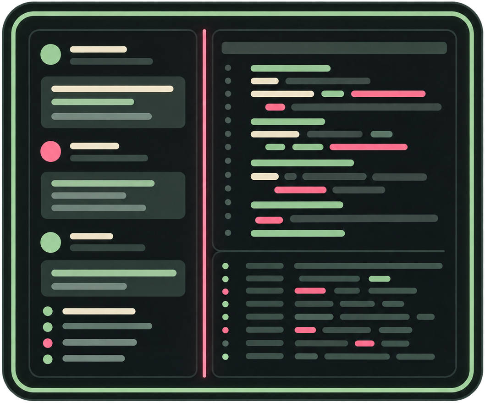
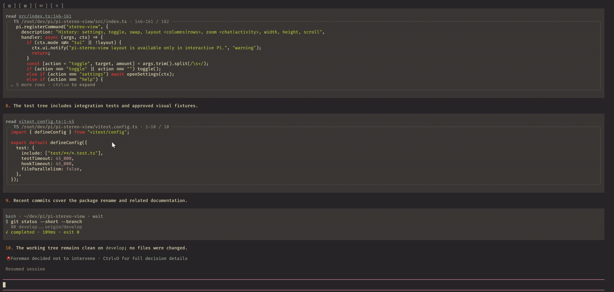
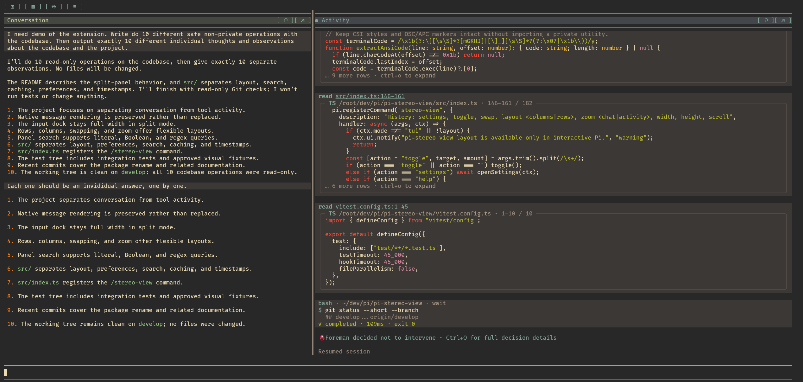
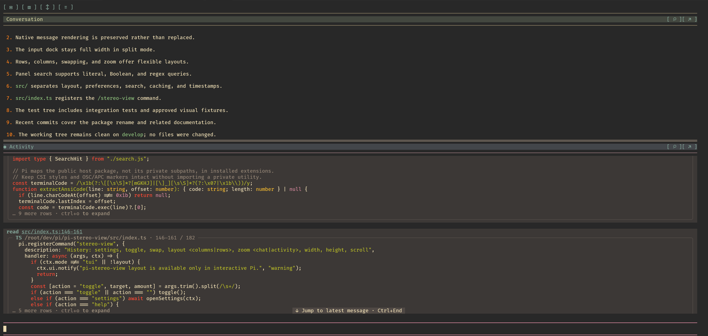

<h1 align="center">
  <br>
  pi-stereo-view
</h1>

<p align="center">Keep Pi conversation separate from tool output and agent activity.</p>

<p align="center">
  <a href="https://www.npmjs.com/package/pi-stereo-view"></a>
  <a href="https://www.npmjs.com/package/pi-stereo-view"></a>
  <a href="https://github.com/alexshpunt/pi-stereo-view/actions/workflows/ci.yml"></a>
  <a href="./LICENSE"></a>
</p>

You come back to a chat and can't remember what you were talking about?

**Split tool output from the agent's replies with pi-stereo-view.**

The chat becomes two zones: your conversation with the agent, and the agent's work where it calls tools.

| Zone | What's in it |
| --- | --- |
| **Conversation** | Your messages, the LLM's replies, summaries and system information, including welcome, loaded resources, warnings, errors and status notices at any time. |
| **Activity** | Thinking, tool calls and results, related tool output, and shell execution. |

Unrecognized content stays in Conversation unless its metadata links it to a known tool call.

Late output linked to a tool call appears directly below that call in Activity, even if other work has happened since. Combined history keeps its original order.

Expand a parent tool such as Codemode to browse its nested call tree. Adjacent calls of the same tool form a group with individual call headers. Each independent native result opens under its call. A combined result covering several calls stays whole inside their group. Panels without child execution identities remain available inside the parent's output disclosure. Session restoration uses Pi's saved nested-call metadata and the original saved panels.

Messages and tools keep their familiar appearance. Extension widgets and inline dialogs appear at the bottom of Activity, below its independently scrolling history. Standard select, confirm, input and editor dialogs and non-overlay custom components keep Pi's native input, focus and completion behavior. The message editor, including extension-provided replacements, stays full width whenever Pi displays it. Explicit overlays keep their native placement.

If the Activity surface cannot fit without clipping, the view temporarily returns to combined history and Pi's normal placement. Combined history, zoomed Conversation and unsupported native layouts also leave dialogs and widgets in Pi's dock. Open forms stay live as layouts change and disappear when their producer closes them; they are not added to history.

## Features

- Arrange Conversation and Activity in columns or rows, swap or resize the panels, and zoom either one while keeping the input full width.
- Group consecutive Activity tools and expand individual calls inline while keeping thinking visible.
- Copy an individual user message, assistant reply or thinking block with its own copy icon.
- Copy a complete tool call with its arguments, saved result and linked late output, including collapsed and off-screen text.
- Search panel history with literal text, Boolean expressions or regular expressions, then jump between matches.
- Show or hide timestamps and copy icons independently. Layout and display settings survive restart.

## See it in action



[Watch the full demo](https://github.com/alexshpunt/pi-stereo-view/releases/download/v0.1.0/demo.mp4).

### Columns

Conversation beside Activity, with a full-width input below both panels.



### Rows

Conversation above Activity. Swap the panels whenever you need a different order.



## Install

```sh
pi install npm:pi-stereo-view
```

Split history needs Pi's **fullscreen** mode. Choose it in `/settings`, or start Pi with:

```sh
pi --tui-mode fullscreen
```

## Use it

Click the toolbar and the buttons in each panel's header. Buttons use icons by default. To use text instead, open **Stereo View settings** with `[ ≡ ]` or `/stereo-view settings`, then set **Button style** to `text`. The choice survives restart.

| Icons | Text | Action |
| --- | --- | --- |
| `[ ▣ ]` / `[ ◫ ]` | `[Join]` / `[Open]` | Turn split history off / on. |
| `[ ▤ ]` / `[ ▥ ]` | `[Rows]` / `[Cols]` | Switch between rows and columns. |
| `[ ↕ ]` / `[ ↔ ]` | `[Swap]` | Swap the panels. |
| `[ ↗ ]` / `[ ↙ ]` | `[Max]` / `[Out]` | Zoom a panel / restore the split. |
| `[ ≡ ]` | `[Menu]` | Open display and Conversation height settings. |
| `[ ⌕ ]` | `[Find]` | Search this panel. |
| `[ ⊟ ]` / `[ ⊞ ]` | `[Few]` / `[All]` | Compact Activity tools / restore full tools. |

**Resize:** drag the double line between the panels — `═` in rows, `║` in columns.

New installs start in Columns: Conversation gets 20% of the width on the left, and Activity gets 80% on the right. Drag the divider or use the size shortcuts to change this.

In Rows, Conversation grows with its messages up to half the available history area, then scrolls. Dragging the divider or setting a height changes that limit. Choose **Conversation height: auto** in settings, or run `/stereo-view height auto`, to restore automatic sizing.

Panels fit short content and scroll when history fills up. Each panel has its own scrolling, text selection and copy.

Swap the panels whenever you want. Zoom a panel to give it the whole history area; the input stays visible. Restore it to return to your split. Turning split off returns to one combined history; the toolbar stays available to turn it back on.

## Compact Activity

Click `[ ⊟ ]` or `[Few]` beside Search and Maximize in the Activity header to show compact tool calls. Adjacent calls to the same tool in the same state share a header with a count; every failed call stays separate, even beside another failure. Click that header to show the individual compact rows, then click a row to open its original full card and linked output. Left guides mark each level: members sit inside their group, and an open card and its linked output sit inside their call. Collapse a call or its group independently; reopening the group keeps your expanded calls. Thinking, Conversation content and different tools end a group.

Group and call headers show `▸` when collapsed and `▾` when expanded. Each call row has a one-cell left gutter, a colored status dot, its tool name and a short argument description. A group shows its shared running or successful state. Failed calls expose their own status and argument preview without opening a group. Long descriptions are truncated, not the saved calls. Verified local MCP forwarding aliases use their native tool's name; foreign, ambiguous and unknown tools keep their original identity.

Search and `/stereo-view copy` still include full saved results and linked output. A search match opens its group and call temporarily; clearing the search restores your previous expansion. You can also click `[ ⊞ ]` or `[All]` in the Activity header to restore full tools. Conversation and combined history keep their normal display.

Compact tools work in columns, rows and zoomed Activity. The choice survives restart and defaults to off. For keyboard access, run `/stereo-view settings` and change **Compact Activity tools**.

## Search history

Press **Ctrl+F** to search the last clicked or scrolled panel. The active panel's header is highlighted and, when space permits, marked with a dot; Conversation is active initially. The `[ ⌕ ]` / `[Find]` button always searches its own panel.

Type a word or phrase to find it without case sensitivity. Combine terms with `AND`, `OR`, `NOT` and parentheses. Put phrases in quotes to keep them together, or start with `regex:` for a regular expression.

| Example | Finds |
| --- | --- |
| `worker ready` | The literal phrase “worker ready”. |
| `worker AND ready NOT failed` | Lines containing both “worker” and “ready”, but not “failed”. |
| `(worker OR server) AND "ready now"` | Lines containing either term and the phrase “ready now”. |
| `regex:worker_[0-9]+` | Names such as `worker_12`. |

Press **Enter** or `[↓]` for the next match, and **Shift+Enter** for the previous one. The counter shows your position and the total matches. Ctrl+F returns to the search field without clearing your query.

Search covers the whole current conversation branch, including off-screen messages, hidden thinking and collapsed tool output. It does not search other branches, sessions, attachments or files. Russian and English queries work.

A match is revealed in its own panel without moving the other one. If matching text cannot be shown inside a tool result, a temporary **Search match:** fragment shows it. Copying keeps the original text, without highlight colours.

**Regex search requires ripgrep (`rg`) to be installed.** Invalid queries and search errors appear in the search field instead of showing incomplete results.

Press **Escape** or `[×]` to close search and restore your previous scroll position. Your message draft stays unchanged. Close other dialogs before searching. Search is available in split fullscreen history; combined history and regular mode keep Pi's usual keyboard behaviour.

## Copy a block

Click `⧉` or `[Copy]` below the right corner of a message, thinking, tool or other history block to copy its text. Blocks without a known time have no copy button. Copy buttons work in split and zoomed panels, even with timestamps hidden.

Messages and thinking keep their original text/Markdown, without terminal colours, clocks or copy buttons. Copying a tool includes its name, arguments, saved result and linked late output. A late-output block also has its own button to copy just that block. Collapsed and off-screen text is included.

During streaming, each click copies the content available at that moment. Copy uses only text already available in Pi; it does not fetch omitted output or copy binary attachments. Custom blocks without source text fall back to plain rendered text.

For keyboard access, run `/stereo-view copy` and choose a numbered block from the active panel. It copies the same text as that block's button.

Use **Show copy buttons** in Stereo View settings to hide the buttons and their rows. This choice survives restart. Keyboard copying stays available when the buttons are hidden.

## Timestamps

Conversation and Activity can show a dim local `HH:mm:ss` clock above each block on the left, with a small inset. The copy button sits below the block on the right, so neither control takes width away from the text. New tool calls show their start time.

In compact Activity, clocks sit at the start of the same line on the left, before the status and tool name, when space permits. A group shows its first call's original time; expanded member rows show their own. Opening a full card does not repeat its clock.

Older tool calls may show `~HH:mm:ss` for an approximate time. Blocks without a known time show neither a clock nor a copy button; their content stays visible.

Use Stereo View settings to hide or show clocks. This setting survives restart. Clocks appear in split and zoomed panels, not in combined history. They are display-only and are not added to the conversation sent to the model.

## Commands and shortcuts

The same controls are available without the mouse:

| Action | Command |
| --- | --- |
| Split off / on | `/stereo-view` |
| Swap panels | `/stereo-view swap` |
| Rows / columns | `/stereo-view layout rows` / `/stereo-view layout columns` |
| Conversation height / width | `/stereo-view height 12` / `/stereo-view width 40` |
| Automatic Conversation height | `/stereo-view height auto` |
| Scroll a panel | `/stereo-view scroll chat -10` / `/stereo-view scroll activity -10` |
| Zoom / restore Conversation | `/stereo-view zoom chat` |
| Zoom / restore Activity | `/stereo-view zoom activity` |
| Copy a block from the active panel | `/stereo-view copy` |
| Display settings | `/stereo-view settings` |
| Button legend | `/stereo-view help` |

`Ctrl+Alt+T` toggles split, `Ctrl+Alt+S` swaps panels, and `Ctrl+Alt+Left/Right` resizes Conversation along the current split direction.

Keyboard scrolling (`PgUp`/`PgDn` and Pi's other scroll keys) moves the active panel, marked with `●`. Clicking or scrolling a panel makes it active. `Ctrl+Alt+Up` or `Ctrl+Alt+Down` switches to the other panel; press either again to switch back.

## Settings and limits

Your layout, panel order, sizes, compact Activity choice, timestamp and copy-button settings are saved automatically. Each new session opens both panels in that arrangement. Zooming one panel or turning split off is temporary and does not carry over to another session.

- Tested with Pi 1.1.0. Requires Node.js 22.19 or newer.
- Regular mode shows one combined history.
- If the terminal is too small, history temporarily combines without forgetting your split.
- If your Pi version cannot display the split, normal history stays visible and a warning explains the problem.

## License

[MIT](LICENSE) · [Developer guide](https://github.com/alexshpunt/pi-stereo-view/blob/main/development.md)
